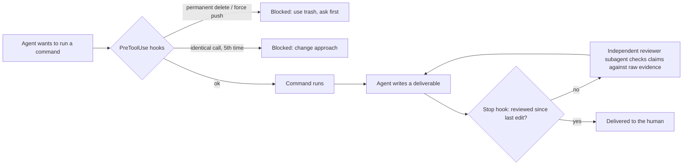
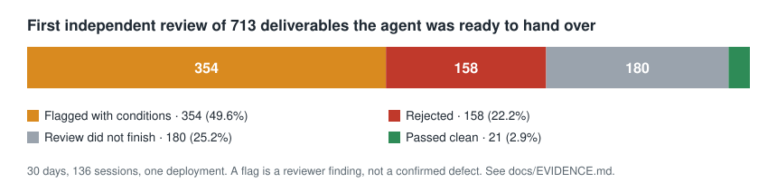

# agent-guardrails

[](https://github.com/career6174/agent-guardrails/actions/workflows/test.yml)
[繁體中文版喺下面](#zh-hant)

**A small, tested framework for making AI coding agents trustworthy in daily use: three hooks, a review loop, and the 14 working rules behind them.**

Built from months of running Claude Code agents around the clock. On that deployment, an independent reviewer flagged at least one issue in **72% of the 713 deliverables** an agent was about to hand over, of which 22% of all deliverables were rejected outright ([evidence and its limits](docs/EVIDENCE.md)).



## Install in one command

```bash
curl -fsSL https://raw.githubusercontent.com/career6174/agent-guardrails/main/install.sh | bash
```

It downloads this repo next to your Claude Code config, registers the three hooks, copies the two subagents, and ends by showing you a live block. Your `settings.json` is backed up first, running it twice changes nothing, and `--uninstall` takes it all out again. [Other ways to install](#install-three-routes) · [Cannot install it as it is?](#if-you-cannot-install-it-whole)

## 1. The problem

Agents that can edit files and run commands are productive, and they fail in a few predictable ways:

| What the agent does | What it costs you |
|---|---|
| Deletes permanently, or runs `git stash` / `reset --hard` in the wrong place | One stash swept away 6,033 uncommitted files that other sessions were using |
| Retries the same failing call again and again | Tokens and time burn while the real error scrolls out of view |
| Says "done" from its own summary, without opening the result | Reports with untraced numbers; jobs that "succeed" and do nothing |
| Trusts silence: zero results, empty output, "no change" | A filter silently dropped 353 of 499 records before anything looked at them |
| Makes a promise ("I'll check on Thursday") that no session will keep | Follow-ups quietly disappear |

Telling the model to be careful does not fix this. A prompt is advice, and advice gets dropped halfway through a long task.

## 2. The solution

The thinking, in three questions asked of every failure in the table above:

1. **Can a program detect it?** Then do not ask the model to remember. Put a check at the exact point where the agent acts (before a tool call, or at the moment it says "done").
2. **If a program cannot, can a second agent?** Give it the result, not the author's opinion of the result, and make it show evidence for every claim.
3. **What happens when the check itself is wrong?** It must step aside. A guard that traps the user is worse than no guard.

So: put deterministic checks where the agent touches the world, and make a second agent verify the result before a human sees it.

| Layer | What it does | In this repo |
|---|---|---|
| **Guard the tool call** | Block destructive deletes and history rewrites; stop identical retries | [`hooks/safe_delete_guard.py`](hooks/safe_delete_guard.py), [`hooks/repeat_guard.py`](hooks/repeat_guard.py) |
| **Gate the word "done"** | The agent cannot finish while a deliverable is unreviewed; editing after review re-arms the gate | [`hooks/review_gate.py`](hooks/review_gate.py) |
| **Independent review** | A separate subagent must match every claim to evidence: a path and line, a command, a rendered page | [`agents/reviewer.md`](agents/reviewer.md) |
| **Prior art first** | A read-only scout checks whether the thing already exists before anything is built | [`agents/scout.md`](agents/scout.md) |
| **Working rules** | 14 rules, each with the reason it exists and how it is enforced | [`docs/PLAYBOOK.md`](docs/PLAYBOOK.md) |
| **Instruction file and memory layout** | A short always-loaded rule file and a layered memory that does not rot | [`templates/CLAUDE.md`](templates/CLAUDE.md), [`templates/memory/`](templates/memory/README.md) |

## 3. Why this design

- **Rules the model cannot forget.** Hooks run outside the model. They behave the same on the first call and the five-hundredth.
- **Maker and checker are different agents.** The reviewer gets the artefact, not the author's conclusion. Banks and insurers use the same control for payments and underwriting; here it is applied to agent output.
- **Fail open.** A crashed guard lets the agent continue, and a gate gives up after three blocks on the same files. A broken guardrail never traps the user. Both behaviours are tested.
- **Small enough to audit.** Three hooks, standard-library Python, no dependencies, under 300 lines. You can read all of it before you trust it.
- **Measurable.** Every verdict and every block can be logged, so "does it help?" becomes a query you can run.

## 4. Proof

From one deployment, 2026-10-24 to 2026-11-22 (30 days, 136 sessions). These numbers come from the original, larger private deployment. The three hooks in this repo are a clean-room port of its core and have not produced these numbers themselves.



| | |
|---|---|
| Deliverables that went through independent review | **713** |
| Flagged on first review (conditional or rejected) | **512 (71.8%)** |
| Rejected outright on first review | 158 (22.2%) |
| Passed clean on first review | 21 (2.9%) |
| First review did not finish | 180 (25.2%) |
| Times a final answer was blocked because nothing had been reviewed (since 2026-11-05) | 357 blocks |
| Untracked promises caught and sent back (since 2026-11-15) | 55 of 86 |

And this repository, reviewed with its own loop before release:

| Review round | Found | Tests |
|---|---|---|
| 1 | Delete guard missed 6 spellings, e.g. `xargs`, `find -delete`, `bash -c` | 9 → 35 |
| 2 | `sudo -u`, `bash -lc`, `eval`, `git push origin +main` got through | 35 → 50 |
| 3 | Normal edit-and-retest loops would be blocked; gate could be exhausted | 50 → 52 |
| 4 | Pass | 52 |
| 5 (final approver) | Shell keywords hid the delete: `for … do`, `if … then`, `{ }`, `timeout`, `xargs -n 1`; one guard could crash on odd input | 53 → 62 |

Round 1 started from green tests. The author's tests only covered what the author thought of.

**Read the limits before quoting these numbers:** a flag is a reviewer finding, not a confirmed defect (the false-positive rate has not been measured); there is no control group; the reviewer is also a model; one user, one month. Method, recompute script and caveats are in [docs/EVIDENCE.md](docs/EVIDENCE.md).

## Install: three routes

Pick **one**. All three give you the same hooks and subagents.

| Route | Command | Best when |
|---|---|---|
| **A. Terminal** (macOS, Linux, WSL, Git Bash) | `curl -fsSL https://raw.githubusercontent.com/career6174/agent-guardrails/main/install.sh \| bash` | You want it working in a minute |
| **B. Ask your agent** | Paste into Claude Code: `Install agent-guardrails for me. Follow https://raw.githubusercontent.com/career6174/agent-guardrails/main/INSTALL.md and show me each command before you run it.` | You would rather watch the agent do it, or your setup is unusual |
| **C. Claude Code plugin** | `claude plugin marketplace add career6174/agent-guardrails && claude plugin install agent-guardrails@agent-guardrails` | You manage everything as plugins; update and removal go through `/plugin` |

Windows Command Prompt (PowerShell version in [INSTALL.md](INSTALL.md#other-routes)): `git clone https://github.com/career6174/agent-guardrails "%USERPROFILE%\.claude\agent-guardrails" && python "%USERPROFILE%\.claude\agent-guardrails\install.py"`

What route A and B change on your machine:

| Step | What happens | Safety |
|---|---|---|
| Download | Repo is cloned to `~/.claude/agent-guardrails` | Nothing else is fetched; no dependencies |
| Hooks | Three entries are added to `~/.claude/settings.json` | Old file is backed up first; your other hooks and settings are untouched; invalid JSON makes it stop without writing |
| Subagents | `reviewer.md` and `scout.md` are copied to `~/.claude/agents/` | If you already have a file with that name, yours is kept; uninstall removes only files it created |
| Proof | A pretend dangerous command is fed to the delete guard and you see it blocked | Nothing real is deleted |

```bash
python3 ~/.claude/agent-guardrails/install.py --dry-run     # preview, write nothing
python3 ~/.claude/agent-guardrails/install.py --doctor      # check an install
python3 ~/.claude/agent-guardrails/install.py --uninstall   # remove what was added
```

Then restart Claude Code. Details, manual steps and troubleshooting: [INSTALL.md](INSTALL.md).

Requires Python 3.10+, git, and a Claude Code version with hooks and subagents. CI runs the unit tests and a full install, re-install, check and uninstall on Linux, macOS and Windows. The block message suggests `trash-put`, which comes from `trash-cli`. The instruction file is not installed for you, because it is yours to write: start from [`templates/CLAUDE.md`](templates/CLAUDE.md).

## If you cannot install it whole

Company-managed settings, a different agent tool, hooks of your own that clash, or you only want one piece: the ideas still transfer. [docs/ADAPT.md](docs/ADAPT.md) explains the thinking step by step and gives a route for each situation.

| Your situation | What to do |
|---|---|
| You may not change your user settings | Install into one project only: `CLAUDE_CONFIG_DIR=./.claude python3 install.py` |
| You want one guard, not all three | Copy one file from `hooks/` and add one entry to your settings ([snippets](INSTALL.md#manual-install)) |
| You use another agent tool | The checks are plain Python functions and the subagents are plain Markdown; [port them](docs/ADAPT.md#4-porting-to-another-agent-tool) |
| Your tool has no hooks at all | Use the rules and the reviewer prompt as text; weaker, and the guide says how much |
| You want to build your own guards | Follow the [five-step recipe](docs/ADAPT.md#5-build-your-own-guard-in-five-steps) this repo was built with |

## Configure

| Env var | Default | Meaning |
|---|---|---|
| `REPEAT_GUARD_WARN` / `REPEAT_GUARD_BLOCK` | 3 / 5 | identical-call thresholds |
| `REPEAT_GUARD_IGNORE` | `Read,Grep,Glob,LS,TodoWrite` | tools never counted as repeats |
| `REVIEW_GATE_PATTERN` | `\.(html\|py\|sql\|ipynb)$` | which files count as deliverables |
| `REVIEW_GATE_AGENT` | `reviewer` | subagent name that clears the gate |
| `REVIEW_GATE_MAX_BLOCKS` | 3 | blocks per set of pending files before failing open |

State files live in `~/.cache/agent-guardrails/` (a few bytes per session); clear them any time.

## Scope: a seatbelt, not a sandbox

The hooks catch the *accidental* destructive commands agents really produce (wrappers like `sudo -u`, `bash -lc`, `eval`, `xargs`, `find -delete`, force-push, `git checkout -- file`). They are **not a security boundary**: a deliberate `python -c "shutil.rmtree(...)"` or an encoded command will get through. Quoted text is treated conservatively (`echo "a; rm b"` is blocked). Plain `git stash` is allowed because it is recoverable; only `stash drop` and `stash clear` are blocked. For heavier protection see [dcg](https://github.com/Dicklesworthstone/destructive_command_guard) or [cc-safety-net](https://github.com/kenryu42/cc-safety-net); this repo stays small enough to read in ten minutes.

## Test

```bash
pip install pytest && pytest -q tests
```

## Roadmap

- [ ] Labelled evaluation set from real agent transcripts: catch rate and false-block rate per hook
- [ ] Port the promise-ledger and status-line stop hooks (rules 11 and 12 in the playbook)
- [ ] Verdict ledger writer, so `evidence/compute.py` works out of the box
- [ ] Adapters for other agent CLIs

Issues and pull requests are welcome, especially bypasses of the delete guard: each one becomes a test.

MIT License.

---

<a id="zh-hant"></a>

# agent-guardrails（AI 助手安全閘）繁體中文版

[English version above](#agent-guardrails)

**一套細小、有測試嘅框架，令 AI 編程助手喺日常工作入面信得過：3 個自動攔截器（hook）、一個審查循環，加 14 條工作守則。**

呢套嘢嚟自幾個月日夜運行 Claude Code 助手嘅經驗。喺嗰個環境入面，助手準備交出嘅 713 份成果，有 **72%** 第一次審就被獨立審查員指出最少一個問題；以全部 713 份計，有 22% 直接被拒（[證據同限制](docs/EVIDENCE.md)）。

## 一個指令裝好

```bash
curl -fsSL https://raw.githubusercontent.com/career6174/agent-guardrails/main/install.sh | bash
```

佢會將呢個 repo 下載去你 Claude Code 設定資料夾隔籬，登記 3 個攔截器，抄 2 個子助手過去，最後即場示範一次攔截畀你睇。改 `settings.json` 之前會先備份；跑兩次都唔會重複；`--uninstall` 可以成套拆走。[其他安裝方法](#安裝三條路) · [冇辦法成套搬？](#如果冇辦法成套搬過去)

## 1. 遇到乜問題

AI 助手可以自己改檔、跑指令，做嘢好快，但下面幾種錯會重複出現。

| 助手做咗乜 | 代價 |
|---|---|
| 永久刪檔，或者喺錯嘅地方跑 `git stash`／`reset --hard` | 一次 stash 掃走咗 6,033 個未儲存嘅檔案，其他工作一齊中招 |
| 同一個失敗嘅動作不停重試 | 錢同時間不停燒，真正嘅錯誤訊息被洗走 |
| 冇打開成果睇過，就憑自己嘅總結話「做完」 | 報告入面有冇人核過嘅數字；工作顯示「成功」但其實乜都冇做 |
| 見到「零結果／冇變化」就信 | 一個過濾器靜靜剔走咗 499 筆入面嘅 353 筆，冇人發現 |
| 應承「星期四我會檢查」，但到時冇人記得 | 跟進事項無聲無息消失 |

叫 AI「小心啲」解決唔到。提示只係建議，長工作做到一半就會被拋低。

## 2. 我哋嘅解決方法

上面每一種錯，我哋都順序問三條問題。

1. **程式驗唔驗得到？** 驗得到就唔好靠模型記住。喺助手落手嗰一下放一個檢查（用工具之前，或者講「做完」嗰一刻）。
2. **程式驗唔到，第二個助手驗唔驗得到？** 畀佢睇成果本身，唔係作者點形容個成果，再要佢逐項攞證據。
3. **個檢查自己錯咗點算？** 佢要識讓路。困住用家嘅攔截器，衰過冇攔截器。

所以：喺助手「落手」嘅位置放死規則，再搵第二個助手喺人見到成果之前核對一次。

| 層 | 做乜 | 檔案 |
|---|---|---|
| **攔住危險動作** | 擋永久刪除同改寫歷史；擋住一模一樣嘅重試 | `hooks/safe_delete_guard.py`、`hooks/repeat_guard.py` |
| **攔住「做完」兩個字** | 成果未經審查，助手收唔到工；審完再改，要再審 | `hooks/review_gate.py` |
| **獨立審查** | 另一個助手逐項核對：每個講法都要有證據（檔案第幾行、指令、畫面） | `agents/reviewer.md` |
| **先搵現成方案** | 開工前先查有冇人做過 | `agents/scout.md` |
| **工作守則** | 14 條，每條寫明點解要有、點樣強制執行 | `docs/PLAYBOOK.md` |
| **指令檔同記憶佈局** | 一份短嘅常駐規則，加分層記憶 | `templates/CLAUDE.md`、`templates/memory/` |

## 3. 點解呢個設計好

- **模型唔會「唔記得」。** 攔截器喺模型外面運行，第 1 次同第 500 次表現一樣。
- **做嘅人同核嘅人分開。** 審查員攞到嘅係成果本身，唔係作者嘅結論。銀行同保險公司批款、核保用嘅「一人做、一人核」，搬嚟用喺 AI 身上。
- **壞咗都唔會困住人。** 攔截器自己出錯會放行；同一批檔案擋夠 3 次就放手。兩樣都有測試。
- **細到可以成份讀完。** 3 個攔截器、純 Python、零依賴、少過 300 行。
- **量度得到。** 每個判決、每次攔截都可以記錄，「有冇用」可以用數字答。

## 4. 點樣證明有用

同一個環境，2026-10-24 至 2026-11-22（30 日、136 次工作）。呢啲數字嚟自原本規模更大嘅私人環境；呢個 repo 嘅 3 個攔截器係佢核心部分嘅重寫版，本身未產生過呢啲數字。


| 項目 | 數字 |
|---|---|
| 經獨立審查嘅成果 | **713 份** |
| 第一次審就被指出問題 | **512 份（71.8%）** |
| 第一次審直接被拒 | 158 份（22.2%） |
| 第一次審就完全通過 | 21 份（2.9%） |
| 第一次審未完成 | 180 份（25.2%） |
| 因為未經審查而被攔住嘅「做完」（由 2026-11-05 起計） | 357 次 |
| 冇記低跟進而被打回頭嘅承諾（由 2026-11-15 起計） | 86 次入面 55 次 |

呢個 repo 出街前都用同一個循環審過，一共四輪。

| 審查輪次 | 搵到乜 | 測試數 |
|---|---|---|
| 1 | 刪檔攔截漏咗 6 種寫法 | 9 → 35 |
| 2 | 再漏幾類，例如 `sudo -u`、`bash -lc` | 35 → 50 |
| 3 | 正常「改完再測」會被誤擋 | 50 → 52 |
| 4 | 通過 | 52 |
| 5（最終審批） | `for … do`、`if … then`、`timeout` 呢類寫法入面嘅刪檔漏擋 | 53 → 62 |

第 1 輪開始時測試係全部通過嘅。作者寫嘅測試，只會測到作者諗到嘅情況。

**引用數字前請先睇限制：** 「被指出問題」係審查員嘅意見，唔等於證實有錯（誤報率未量度）；冇對照組；審查員本身都係 AI；只有一個用家、一個月。計法同限制見 [docs/EVIDENCE.md](docs/EVIDENCE.md)。

## 範圍：係安全帶，唔係保險箱

呢啲攔截器擋嘅係 AI 助手「唔小心」打出嚟嘅危險指令，唔係安全邊界；有人刻意繞過係擋唔到嘅。

## 安裝：三條路

三揀**一**，裝到嘅嘢一樣。

| 路 | 指令 | 啱邊種人 |
|---|---|---|
| **A. 終端機**（macOS、Linux、WSL、Git Bash） | `curl -fsSL https://raw.githubusercontent.com/career6174/agent-guardrails/main/install.sh \| bash` | 想一分鐘內用得 |
| **B. 叫你個助手裝** | 喺 Claude Code 貼：`Install agent-guardrails for me. Follow https://raw.githubusercontent.com/career6174/agent-guardrails/main/INSTALL.md and show me each command before you run it.` | 想睇住助手做，或者部機設定比較特別 |
| **C. Claude Code 外掛** | `claude plugin marketplace add career6174/agent-guardrails && claude plugin install agent-guardrails@agent-guardrails` | 樣樣都用外掛管；更新同移除都經 `/plugin` |

Windows 命令提示字元（PowerShell 版見 [INSTALL.md](INSTALL.md#other-routes)）：`git clone https://github.com/career6174/agent-guardrails "%USERPROFILE%\.claude\agent-guardrails" && python "%USERPROFILE%\.claude\agent-guardrails\install.py"`

A 同 B 兩條路會改你部機以下四樣嘢。

| 步驟 | 做乜 | 安全措施 |
|---|---|---|
| 下載 | 將 repo 放去 `~/.claude/agent-guardrails` | 唔會再下載其他嘢，零依賴 |
| 攔截器 | 喺 `~/.claude/settings.json` 加 3 項 | 先備份舊檔；你原有嘅攔截器同設定唔郁；個檔格式有錯就停手唔寫 |
| 子助手 | 抄 `reviewer.md`、`scout.md` 去 `~/.claude/agents/` | 你已經有同名檔就保留你嗰個；拆走時只刪安裝程式自己建立嘅檔 |
| 證明 | 餵一個假嘅危險指令畀刪檔攔截，你會見到佢被擋 | 唔會真係刪任何嘢 |

```bash
python3 ~/.claude/agent-guardrails/install.py --dry-run     # 預覽，乜都唔寫
python3 ~/.claude/agent-guardrails/install.py --doctor      # 檢查裝成點
python3 ~/.claude/agent-guardrails/install.py --uninstall   # 拆走裝過嘅嘢
```

裝完重開 Claude Code。詳細步驟、人手安裝同常見問題見 [INSTALL.md](INSTALL.md)（英文）。

需要 Python 3.10 或以上同 git，另外 Claude Code 要支援攔截器同子助手。自動測試會喺 Linux、macOS、Windows 三個系統各跑一次單元測試，再實際裝一次、重裝、自檢同拆走。指示檔唔會幫你裝，因為嗰份應該由你自己寫：由 [`templates/CLAUDE.md`](templates/CLAUDE.md) 開始改。

## 如果冇辦法成套搬過去

可能公司統一管設定，可能你用緊第二款 AI 助手，可能你自己嘅攔截器會撞，又或者你只想要其中一件。無論邊種，個諗法照樣搬得走。[docs/ADAPT.zh-Hant.md](docs/ADAPT.zh-Hant.md) 一步一步講成個思路，每種情況都有一條路。

| 你嘅情況 | 點做 |
|---|---|
| 唔可以改個人設定 | 只裝落一個專案：`CLAUDE_CONFIG_DIR=./.claude python3 install.py` |
| 只想要一個攔截器 | 喺 `hooks/` 抄一個檔，設定加一項（[範例](INSTALL.md#manual-install)） |
| 用第二款 AI 助手 | 檢查係純 Python 函數、子助手係純 Markdown：[照住搬](docs/ADAPT.zh-Hant.md#4-搬去第二款-ai-助手) |
| 個工具完全冇攔截功能 | 將守則同審查員提示當文字用；效果弱啲，文檔有講弱幾多 |
| 想自己整攔截器 | 跟呢個 repo 用嘅[五步做法](docs/ADAPT.zh-Hant.md#5-五步整你自己嘅攔截器) |

MIT License。
