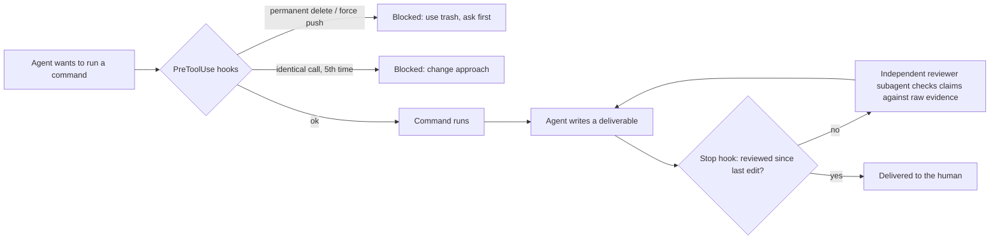

# agent-guardrails

[](https://github.com/career6174/agent-guardrails/actions/workflows/test.yml)
[繁體中文](README.zh-Hant.md)

**A small, tested framework for making AI coding agents trustworthy in daily use: three hooks, a review loop, and the 14 working rules behind them.**

Built from months of running Claude Code agents around the clock. On that deployment, an independent reviewer flagged at least one issue in **72% of the 713 deliverables** an agent was about to hand over, of which 22% of all deliverables were rejected outright ([evidence and its limits](docs/EVIDENCE.md)).



## Install in one command

```bash
curl -fsSL https://raw.githubusercontent.com/career6174/agent-guardrails/main/install.sh | bash
```

It downloads this repo next to your Claude Code config, registers the three hooks, copies the two subagents, and ends by showing you a live block. Your `settings.json` is backed up first, running it twice changes nothing, and `--uninstall` takes it all out again. [Other ways to install](#install-three-routes) · [Cannot install it as it is?](#if-you-cannot-install-it-whole)

## 1. The problem

Agents that can edit files and run commands are productive, and they fail in a few predictable ways:

| What the agent does | What it costs you |
|---|---|
| Deletes permanently, or runs `git stash` / `reset --hard` in the wrong place | One stash swept away 6,033 uncommitted files that other sessions were using |
| Retries the same failing call again and again | Tokens and time burn while the real error scrolls out of view |
| Says "done" from its own summary, without opening the result | Reports with untraced numbers; jobs that "succeed" and do nothing |
| Trusts silence: zero results, empty output, "no change" | A filter silently dropped 353 of 499 records before anything looked at them |
| Makes a promise ("I'll check on Thursday") that no session will keep | Follow-ups quietly disappear |

Telling the model to be careful does not fix this. A prompt is advice, and advice gets dropped halfway through a long task.

## 2. The solution

The thinking, in three questions asked of every failure in the table above:

1. **Can a program detect it?** Then do not ask the model to remember. Put a check at the exact point where the agent acts (before a tool call, or at the moment it says "done").
2. **If a program cannot, can a second agent?** Give it the result, not the author's opinion of the result, and make it show evidence for every claim.
3. **What happens when the check itself is wrong?** It must step aside. A guard that traps the user is worse than no guard.

So: put deterministic checks where the agent touches the world, and make a second agent verify the result before a human sees it.

| Layer | What it does | In this repo |
|---|---|---|
| **Guard the tool call** | Block destructive deletes and history rewrites; stop identical retries | [`hooks/safe_delete_guard.py`](hooks/safe_delete_guard.py), [`hooks/repeat_guard.py`](hooks/repeat_guard.py) |
| **Gate the word "done"** | The agent cannot finish while a deliverable is unreviewed; editing after review re-arms the gate | [`hooks/review_gate.py`](hooks/review_gate.py) |
| **Independent review** | A separate subagent must match every claim to evidence: a path and line, a command, a rendered page | [`agents/reviewer.md`](agents/reviewer.md) |
| **Prior art first** | A read-only scout checks whether the thing already exists before anything is built | [`agents/scout.md`](agents/scout.md) |
| **Working rules** | 14 rules, each with the reason it exists and how it is enforced | [`docs/PLAYBOOK.md`](docs/PLAYBOOK.md) |
| **Instruction file and memory layout** | A short always-loaded rule file and a layered memory that does not rot | [`templates/CLAUDE.md`](templates/CLAUDE.md), [`templates/memory/`](templates/memory/README.md) |

## 3. Why this design

- **Rules the model cannot forget.** Hooks run outside the model. They behave the same on the first call and the five-hundredth.
- **Maker and checker are different agents.** The reviewer gets the artefact, not the author's conclusion. Banks and insurers use the same control for payments and underwriting; here it is applied to agent output.
- **Fail open.** A crashed guard lets the agent continue, and a gate gives up after three blocks on the same files. A broken guardrail never traps the user. Both behaviours are tested.
- **Small enough to audit.** Three hooks, standard-library Python, no dependencies, under 300 lines. You can read all of it before you trust it.
- **Measurable.** Every verdict and every block can be logged, so "does it help?" becomes a query you can run.

## 4. Proof

From one deployment, 2026-10-24 to 2026-11-22 (30 days, 136 sessions). These numbers come from the original, larger private deployment. The three hooks in this repo are a clean-room port of its core and have not produced these numbers themselves.


| | |
|---|---|
| Deliverables that went through independent review | **713** |
| Flagged on first review (conditional or rejected) | **512 (71.8%)** |
| Rejected outright on first review | 158 (22.2%) |
| Passed clean on first review | 21 (2.9%) |
| First review did not finish | 180 (25.2%) |
| Times a final answer was blocked because nothing had been reviewed (since 2026-11-05) | 357 blocks |
| Untracked promises caught and sent back (since 2026-11-15) | 55 of 86 |

And this repository, reviewed with its own loop before release:

| Review round | Found | Tests |
|---|---|---|
| 1 | Delete guard missed 6 spellings, e.g. `xargs`, `find -delete`, `bash -c` | 9 → 35 |
| 2 | `sudo -u`, `bash -lc`, `eval`, `git push origin +main` got through | 35 → 50 |
| 3 | Normal edit-and-retest loops would be blocked; gate could be exhausted | 50 → 52 |
| 4 | Pass | 52 |
| 5 (final approver) | Shell keywords hid the delete: `for … do`, `if … then`, `{ }`, `timeout`, `xargs -n 1`; one guard could crash on odd input | 53 → 62 |

Round 1 started from green tests. The author's tests only covered what the author thought of.

**Read the limits before quoting these numbers:** a flag is a reviewer finding, not a confirmed defect (the false-positive rate has not been measured); there is no control group; the reviewer is also a model; one user, one month. Method, recompute script and caveats are in [docs/EVIDENCE.md](docs/EVIDENCE.md).

## Install: three routes

Pick **one**. All three give you the same hooks and subagents.

| Route | Command | Best when |
|---|---|---|
| **A. Terminal** (macOS, Linux, WSL, Git Bash) | `curl -fsSL https://raw.githubusercontent.com/career6174/agent-guardrails/main/install.sh \| bash` | You want it working in a minute |
| **B. Ask your agent** | Paste into Claude Code: `Install agent-guardrails for me. Follow https://raw.githubusercontent.com/career6174/agent-guardrails/main/INSTALL.md and show me each command before you run it.` | You would rather watch the agent do it, or your setup is unusual |
| **C. Claude Code plugin** | `claude plugin marketplace add career6174/agent-guardrails && claude plugin install agent-guardrails@agent-guardrails` | You manage everything as plugins; update and removal go through `/plugin` |

Windows Command Prompt (PowerShell version in [INSTALL.md](INSTALL.md#other-routes)): `git clone https://github.com/career6174/agent-guardrails "%USERPROFILE%\.claude\agent-guardrails" && python "%USERPROFILE%\.claude\agent-guardrails\install.py"`

What route A and B change on your machine:

| Step | What happens | Safety |
|---|---|---|
| Download | Repo is cloned to `~/.claude/agent-guardrails` | Nothing else is fetched; no dependencies |
| Hooks | Three entries are added to `~/.claude/settings.json` | Old file is backed up first; your other hooks and settings are untouched; invalid JSON makes it stop without writing |
| Subagents | `reviewer.md` and `scout.md` are copied to `~/.claude/agents/` | If you already have a file with that name, yours is kept; uninstall removes only files it created |
| Proof | A pretend dangerous command is fed to the delete guard and you see it blocked | Nothing real is deleted |

```bash
python3 ~/.claude/agent-guardrails/install.py --dry-run     # preview, write nothing
python3 ~/.claude/agent-guardrails/install.py --doctor      # check an install
python3 ~/.claude/agent-guardrails/install.py --uninstall   # remove what was added
```

Then restart Claude Code. Details, manual steps and troubleshooting: [INSTALL.md](INSTALL.md).

Requires Python 3.10+, git, and a Claude Code version with hooks and subagents. CI runs the unit tests and a full install, re-install, check and uninstall on Linux, macOS and Windows. The block message suggests `trash-put`, which comes from `trash-cli`. The instruction file is not installed for you, because it is yours to write: start from [`templates/CLAUDE.md`](templates/CLAUDE.md).

## If you cannot install it whole

Company-managed settings, a different agent tool, hooks of your own that clash, or you only want one piece: the ideas still transfer. [docs/ADAPT.md](docs/ADAPT.md) explains the thinking step by step and gives a route for each situation.

| Your situation | What to do |
|---|---|
| You may not change your user settings | Install into one project only: `CLAUDE_CONFIG_DIR=./.claude python3 install.py` |
| You want one guard, not all three | Copy one file from `hooks/` and add one entry to your settings ([snippets](INSTALL.md#manual-install)) |
| You use another agent tool | The checks are plain Python functions and the subagents are plain Markdown; [port them](docs/ADAPT.md#4-porting-to-another-agent-tool) |
| Your tool has no hooks at all | Use the rules and the reviewer prompt as text; weaker, and the guide says how much |
| You want to build your own guards | Follow the [five-step recipe](docs/ADAPT.md#5-build-your-own-guard-in-five-steps) this repo was built with |

## Configure

| Env var | Default | Meaning |
|---|---|---|
| `REPEAT_GUARD_WARN` / `REPEAT_GUARD_BLOCK` | 3 / 5 | identical-call thresholds |
| `REPEAT_GUARD_IGNORE` | `Read,Grep,Glob,LS,TodoWrite` | tools never counted as repeats |
| `REVIEW_GATE_PATTERN` | `\.(html\|py\|sql\|ipynb)$` | which files count as deliverables |
| `REVIEW_GATE_AGENT` | `reviewer` | subagent name that clears the gate |
| `REVIEW_GATE_MAX_BLOCKS` | 3 | blocks per set of pending files before failing open |

State files live in `~/.cache/agent-guardrails/` (a few bytes per session); clear them any time.

## Scope: a seatbelt, not a sandbox

The hooks catch the *accidental* destructive commands agents really produce (wrappers like `sudo -u`, `bash -lc`, `eval`, `xargs`, `find -delete`, force-push, `git checkout -- file`). They are **not a security boundary**: a deliberate `python -c "shutil.rmtree(...)"` or an encoded command will get through. Quoted text is treated conservatively (`echo "a; rm b"` is blocked). Plain `git stash` is allowed because it is recoverable; only `stash drop` and `stash clear` are blocked. For heavier protection see [dcg](https://github.com/Dicklesworthstone/destructive_command_guard) or [cc-safety-net](https://github.com/kenryu42/cc-safety-net); this repo stays small enough to read in ten minutes.

## Test

```bash
pip install pytest && pytest -q tests
```

## Roadmap

- [ ] Labelled evaluation set from real agent transcripts: catch rate and false-block rate per hook
- [ ] Port the promise-ledger and status-line stop hooks (rules 11 and 12 in the playbook)
- [ ] Verdict ledger writer, so `evidence/compute.py` works out of the box
- [ ] Adapters for other agent CLIs

Issues and pull requests are welcome, especially bypasses of the delete guard: each one becomes a test.

MIT License.
