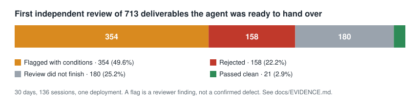

# agent-guardrails（AI 助手安全閘）

[English](README.md)

**一套細小、有測試嘅框架，令 AI 編程助手喺日常工作入面信得過：3 個自動攔截器（hook）、一個審查循環，加 14 條工作守則。**

呢套嘢嚟自幾個月日夜運行 Claude Code 助手嘅經驗。喺嗰個環境入面，助手準備交出嘅 713 份成果，有 **72%** 第一次審就被獨立審查員指出最少一個問題；以全部 713 份計，有 22% 直接被拒（[證據同限制](docs/EVIDENCE.md)）。

## 一個指令裝好

```bash
curl -fsSL https://raw.githubusercontent.com/career6174/agent-guardrails/main/install.sh | bash
```

佢會將呢個 repo 下載去你 Claude Code 設定資料夾隔籬，登記 3 個攔截器，抄 2 個子助手過去，最後即場示範一次攔截畀你睇。改 `settings.json` 之前會先備份；跑兩次都唔會重複；`--uninstall` 可以成套拆走。[其他安裝方法](#安裝三條路) · [冇辦法成套搬？](#如果冇辦法成套搬過去)

## 1. 遇到乜問題

AI 助手可以自己改檔、跑指令，做嘢好快，但下面幾種錯會重複出現。

| 助手做咗乜 | 代價 |
|---|---|
| 永久刪檔，或者喺錯嘅地方跑 `git stash`／`reset --hard` | 一次 stash 掃走咗 6,033 個未儲存嘅檔案，其他工作一齊中招 |
| 同一個失敗嘅動作不停重試 | 錢同時間不停燒，真正嘅錯誤訊息被洗走 |
| 冇打開成果睇過，就憑自己嘅總結話「做完」 | 報告入面有冇人核過嘅數字；工作顯示「成功」但其實乜都冇做 |
| 見到「零結果／冇變化」就信 | 一個過濾器靜靜剔走咗 499 筆入面嘅 353 筆，冇人發現 |
| 應承「星期四我會檢查」，但到時冇人記得 | 跟進事項無聲無息消失 |

叫 AI「小心啲」解決唔到。提示只係建議，長工作做到一半就會被拋低。

## 2. 我哋嘅解決方法

上面每一種錯，我哋都順序問三條問題。

1. **程式驗唔驗得到？** 驗得到就唔好靠模型記住。喺助手落手嗰一下放一個檢查（用工具之前，或者講「做完」嗰一刻）。
2. **程式驗唔到，第二個助手驗唔驗得到？** 畀佢睇成果本身，唔係作者點形容個成果，再要佢逐項攞證據。
3. **個檢查自己錯咗點算？** 佢要識讓路。困住用家嘅攔截器，衰過冇攔截器。

所以：喺助手「落手」嘅位置放死規則，再搵第二個助手喺人見到成果之前核對一次。

| 層 | 做乜 | 檔案 |
|---|---|---|
| **攔住危險動作** | 擋永久刪除同改寫歷史；擋住一模一樣嘅重試 | `hooks/safe_delete_guard.py`、`hooks/repeat_guard.py` |
| **攔住「做完」兩個字** | 成果未經審查，助手收唔到工；審完再改，要再審 | `hooks/review_gate.py` |
| **獨立審查** | 另一個助手逐項核對：每個講法都要有證據（檔案第幾行、指令、畫面） | `agents/reviewer.md` |
| **先搵現成方案** | 開工前先查有冇人做過 | `agents/scout.md` |
| **工作守則** | 14 條，每條寫明點解要有、點樣強制執行 | `docs/PLAYBOOK.md` |
| **指令檔同記憶佈局** | 一份短嘅常駐規則，加分層記憶 | `templates/CLAUDE.md`、`templates/memory/` |

## 3. 點解呢個設計好

- **模型唔會「唔記得」。** 攔截器喺模型外面運行，第 1 次同第 500 次表現一樣。
- **做嘅人同核嘅人分開。** 審查員攞到嘅係成果本身，唔係作者嘅結論。銀行同保險公司批款、核保用嘅「一人做、一人核」，搬嚟用喺 AI 身上。
- **壞咗都唔會困住人。** 攔截器自己出錯會放行；同一批檔案擋夠 3 次就放手。兩樣都有測試。
- **細到可以成份讀完。** 3 個攔截器、純 Python、零依賴、少過 300 行。
- **量度得到。** 每個判決、每次攔截都可以記錄，「有冇用」可以用數字答。

## 4. 點樣證明有用

同一個環境，2026-10-24 至 2026-11-22（30 日、136 次工作）。呢啲數字嚟自原本規模更大嘅私人環境；呢個 repo 嘅 3 個攔截器係佢核心部分嘅重寫版，本身未產生過呢啲數字。



| 項目 | 數字 |
|---|---|
| 經獨立審查嘅成果 | **713 份** |
| 第一次審就被指出問題 | **512 份（71.8%）** |
| 第一次審直接被拒 | 158 份（22.2%） |
| 第一次審就完全通過 | 21 份（2.9%） |
| 第一次審未完成 | 180 份（25.2%） |
| 因為未經審查而被攔住嘅「做完」（由 2026-11-05 起計） | 357 次 |
| 冇記低跟進而被打回頭嘅承諾（由 2026-11-15 起計） | 86 次入面 55 次 |

呢個 repo 出街前都用同一個循環審過，一共四輪。

| 審查輪次 | 搵到乜 | 測試數 |
|---|---|---|
| 1 | 刪檔攔截漏咗 6 種寫法 | 9 → 35 |
| 2 | 再漏幾類，例如 `sudo -u`、`bash -lc` | 35 → 50 |
| 3 | 正常「改完再測」會被誤擋 | 50 → 52 |
| 4 | 通過 | 52 |
| 5（最終審批） | `for … do`、`if … then`、`timeout` 呢類寫法入面嘅刪檔漏擋 | 53 → 62 |

第 1 輪開始時測試係全部通過嘅。作者寫嘅測試，只會測到作者諗到嘅情況。

**引用數字前請先睇限制：** 「被指出問題」係審查員嘅意見，唔等於證實有錯（誤報率未量度）；冇對照組；審查員本身都係 AI；只有一個用家、一個月。計法同限制見 [docs/EVIDENCE.md](docs/EVIDENCE.md)。

## 範圍：係安全帶，唔係保險箱

呢啲攔截器擋嘅係 AI 助手「唔小心」打出嚟嘅危險指令，唔係安全邊界；有人刻意繞過係擋唔到嘅。

## 安裝：三條路

三揀**一**，裝到嘅嘢一樣。

| 路 | 指令 | 啱邊種人 |
|---|---|---|
| **A. 終端機**（macOS、Linux、WSL、Git Bash） | `curl -fsSL https://raw.githubusercontent.com/career6174/agent-guardrails/main/install.sh \| bash` | 想一分鐘內用得 |
| **B. 叫你個助手裝** | 喺 Claude Code 貼：`Install agent-guardrails for me. Follow https://raw.githubusercontent.com/career6174/agent-guardrails/main/INSTALL.md and show me each command before you run it.` | 想睇住助手做，或者部機設定比較特別 |
| **C. Claude Code 外掛** | `claude plugin marketplace add career6174/agent-guardrails && claude plugin install agent-guardrails@agent-guardrails` | 樣樣都用外掛管；更新同移除都經 `/plugin` |

Windows 命令提示字元（PowerShell 版見 [INSTALL.md](INSTALL.md#other-routes)）：`git clone https://github.com/career6174/agent-guardrails "%USERPROFILE%\.claude\agent-guardrails" && python "%USERPROFILE%\.claude\agent-guardrails\install.py"`

A 同 B 兩條路會改你部機以下四樣嘢。

| 步驟 | 做乜 | 安全措施 |
|---|---|---|
| 下載 | 將 repo 放去 `~/.claude/agent-guardrails` | 唔會再下載其他嘢，零依賴 |
| 攔截器 | 喺 `~/.claude/settings.json` 加 3 項 | 先備份舊檔；你原有嘅攔截器同設定唔郁；個檔格式有錯就停手唔寫 |
| 子助手 | 抄 `reviewer.md`、`scout.md` 去 `~/.claude/agents/` | 你已經有同名檔就保留你嗰個；拆走時只刪安裝程式自己建立嘅檔 |
| 證明 | 餵一個假嘅危險指令畀刪檔攔截，你會見到佢被擋 | 唔會真係刪任何嘢 |

```bash
python3 ~/.claude/agent-guardrails/install.py --dry-run     # 預覽，乜都唔寫
python3 ~/.claude/agent-guardrails/install.py --doctor      # 檢查裝成點
python3 ~/.claude/agent-guardrails/install.py --uninstall   # 拆走裝過嘅嘢
```

裝完重開 Claude Code。詳細步驟、人手安裝同常見問題見 [INSTALL.md](INSTALL.md)（英文）。

需要 Python 3.10 或以上同 git，另外 Claude Code 要支援攔截器同子助手。自動測試會喺 Linux、macOS、Windows 三個系統各跑一次單元測試，再實際裝一次、重裝、自檢同拆走。指示檔唔會幫你裝，因為嗰份應該由你自己寫：由 [`templates/CLAUDE.md`](templates/CLAUDE.md) 開始改。

## 如果冇辦法成套搬過去

可能公司統一管設定，可能你用緊第二款 AI 助手，可能你自己嘅攔截器會撞，又或者你只想要其中一件。無論邊種，個諗法照樣搬得走。[docs/ADAPT.zh-Hant.md](docs/ADAPT.zh-Hant.md) 一步一步講成個思路，每種情況都有一條路。

| 你嘅情況 | 點做 |
|---|---|
| 唔可以改個人設定 | 只裝落一個專案：`CLAUDE_CONFIG_DIR=./.claude python3 install.py` |
| 只想要一個攔截器 | 喺 `hooks/` 抄一個檔，設定加一項（[範例](INSTALL.md#manual-install)） |
| 用第二款 AI 助手 | 檢查係純 Python 函數、子助手係純 Markdown：[照住搬](docs/ADAPT.zh-Hant.md#4-搬去第二款-ai-助手) |
| 個工具完全冇攔截功能 | 將守則同審查員提示當文字用；效果弱啲，文檔有講弱幾多 |
| 想自己整攔截器 | 跟呢個 repo 用嘅[五步做法](docs/ADAPT.zh-Hant.md#5-五步整你自己嘅攔截器) |

MIT License。
